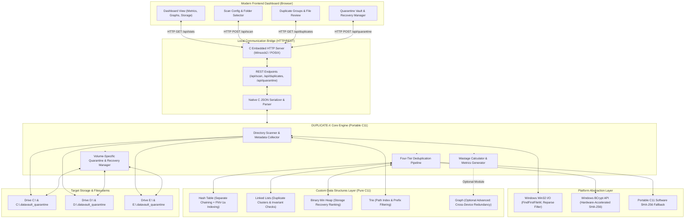

# DUPLICATE-X: System Architecture & Design Specification
## Team DataVault | Academic Year 2026–2027

---

## 1. High-Level Architectural Blueprint

DUPLICATE-X uses a decoupled **Core Engine / Visual Presentation** architecture. All algorithmic complexity, cryptographic hashing, file I/O operations, and custom data structure transformations reside strictly inside the **C Native Backend**. The frontend is a lightweight HTML5/CSS3/JavaScript dashboard communicating via a local REST HTTP bridge.



---

## 2. Component Breakdown & Algorithmic Rigor

### 2.1 File Scanner & Metadata Collector (`backend/src/core/scanner.c`)
* **Recursive Traversal:** Navigates user-specified directories without crossing reparse points or following symlinks.
* **Platform Layer Isolation:** Traversal on Windows uses `FindFirstFileW` / `FindNextFileW` located inside `backend/src/platform/windows/win_io.c`.
* **Metadata Extraction:** Extracts file path, file size in bytes, timestamps, and volume GUID/mount point.
* **Safety Filters:**
  - Ignores zero-byte files (trivially non-unique).
  - Skips system blacklisted paths (`C:\Windows`, `System Volume Information`, `$Recycle.Bin`).
  - Gracefully handles permission errors (`ERROR_ACCESS_DENIED`) by logging non-fatal warnings without crashing.

### 2.2 Four-Tier Deduplication Pipeline (`backend/src/core/dedup.c`)

```mermaid
flowchart LR
    A["Raw Scanned Files"] --> B["Tier 1: File Size Hash Table"]
    B -->|Unique Size| C["Discard (Unique File)"]
    B -->|Size Match (≥ 2 files)| D["Tier 2: Head/Tail Chunk Check"]
    D -->|Chunk Mismatch| C
    D -->|Chunk Match (Candidate)| E["Tier 3: Full SHA-256 Fingerprint"]
    E -->|Hash Mismatch| C
    E -->|SHA-256 Match| F["Tier 4: Byte-by-Byte Verification"]
    F -->|Byte Match| G["Confirmed Duplicate Group"]
```

#### The Four Tiers Explained:
1. **Tier 1 — File Size Pre-filtering ($O(1)$ lookup):**
   * Files with solitary sizes are immediately discarded.
   * *Critical Principle:* File size is merely an initial filter. **Equal file sizes do NOT mean files are duplicates.** Two 1GB video files or ISOs frequently share identical byte lengths while containing completely different data.
2. **Tier 2 — Head/Tail Sample Hashing:**
   * For files with identical sizes, the engine samples the first 4KB and the last 4KB.
   * *Critical Principle:* Sample chunk comparisons **can eliminate candidates, but can never confirm duplicates.** If chunks differ, the files are definitively different; if chunks match, the files remain candidates requiring Tier 3.
3. **Tier 3 — Full SHA-256 Cryptographic Content Fingerprint:**
   * Surviving candidates undergo full-content SHA-256 hashing.
   * *Critical Principle:* **SHA-256 calculates the actual cryptographic file content fingerprint.** FNV-1a or Murmur3 are only used for internal memory hash-table bucket indexing, never for file content identity.
   * *Windows Implementation:* Evaluates the native Windows BCrypt API (CNG / `bcrypt.h` linking `Bcrypt.lib`) for hardware-accelerated SHA-256, alongside a portable C11 software SHA-256 fallback.
4. **Tier 4 — Byte-by-Byte Direct Comparison:**
   * Files sharing an identical SHA-256 digest undergo sequential raw block comparison before committing them to a verified duplicate cluster. This eliminates the theoretical possibility of cryptographic collision before any user action.

### 2.3 Volume-Specific Quarantine & Recovery Manager (`backend/src/core/quarantine.c`)
* **Physical Reality of Cross-Volume Moves:** Moving a file across different volumes (e.g., from `E:\` USB drive to `C:\` SSD) physically requires a data copy followed by source deletion. Such operations **cannot be atomic** at the filesystem level.
* **Volume-Local Quarantine Vaults:** To preserve atomic moves and instant operation, DUPLICATE-X establishes volume-specific staging folders: `<Drive>:\.datavault_quarantine\` (e.g., `C:\.datavault_quarantine`, `D:\.datavault_quarantine`). Files moved within their own volume use atomic filesystem renames (`MoveFileExW` without `MOVEFILE_COPY_ALLOWED`).
* **Verified Cross-Volume Procedure:** If cross-volume consolidation is requested, the engine executes a verified safe procedure:
  $$\text{Copy to Staging} \longrightarrow \text{Verify SHA-256 Match} \longrightarrow \text{Delete Original Source}$$
* **Remaining Copy Count Recheck:** Before moving any file to quarantine, the engine dynamically queries the active duplicate group to verify:
  1. Remaining active copies count $\ge 1$.
  2. The target file is not marked `is_root_copy`.
* **Rollback Manifest:** Every quarantine action is logged to `quarantine_manifest.json` on the respective volume, enabling exact one-click restoration.

### 2.4 Custom Data Structures Layer (`backend/src/ds/`)
* **Hash Table with Separate Chaining:** Indexes file sizes in Tier 1 and SHA-256 digests in Tier 3. Uses FNV-1a for string keys and Murmur3 for integer keys purely for bucket distribution.
* **Dynamic Linked Lists:** Maintains the chain of file instances in a duplicate group, tracking paths, volume tags, and the `is_root_copy` protection flag.
* **Binary Min Heap:** Evaluates recoverable space across all groups, maintaining a Top-K priority queue to surface the most wasteful duplicate groups.
* **Trie (Prefix Tree):** Indexes directory paths for instant $O(L)$ system blacklist checking (`C:\Windows`, `System Volume Information`).
* **Graph (Optional Advanced Feature):** Models cross-volume redundancy and backup relationships between drives. Kept modular and distinct from core deduplication.

---

## 3. Standardized Project Folder Structure

```text
DUPLICATE-X/
|
|-- backend/
|   |-- include/                    # Header files (.h)
|   |   |-- config.h                # Global constants, version, defaults
|   |   |-- status.h                # Standardized system error & status codes
|   |   |-- engine.h                # Engine lifecycle & orchestrator interface
|   |   |-- types.h                 # Core data types (file records, groups)
|   |   |-- ds/                     # Data structure interfaces
|   |   |   |-- hashtable.h
|   |   |   |-- linkedlist.h
|   |   |   |-- minheap.h
|   |   |   |-- trie.h
|   |   |   |-- graph.h             # Optional advanced feature
|   |   |-- core/                   # Deduplication & engine interfaces
|   |   |   |-- scanner.h
|   |   |   |-- dedup.h
|   |   |   |-- quarantine.h
|   |   |   |-- analytics.h
|   |   |-- platform/               # Platform-specific interfaces
|   |   |   |-- win_io.h
|   |   |   |-- win_crypto.h
|   |   |-- api/                    # Server & IPC interfaces
|   |       |-- http_server.h
|   |       |-- json_builder.h
|   |
|   |-- src/                        # Implementation files (.c)
|   |   |-- main.c                  # CLI entry point & smoke test banner
|   |   |-- core/                   # Core engine & pipeline logic
|   |   |   |-- engine.c
|   |   |   |-- scanner.c
|   |   |   |-- dedup.c
|   |   |   |-- quarantine.c
|   |   |   |-- analytics.c
|   |   |   |-- sha256_portable.c   # Portable software C11 fallback
|   |   |-- ds/                     # Custom data structures implementation
|   |   |   |-- hashtable.c
|   |   |   |-- linkedlist.c
|   |   |   |-- minheap.c
|   |   |   |-- trie.c
|   |   |   |-- graph.c             # Optional advanced feature
|   |   |-- platform/
|   |   |   |-- windows/            # Windows-specific implementations
|   |   |       |-- win_io.c        # Win32 FindFirstFileW traversal
|   |   |       |-- win_crypto.c    # BCrypt hardware-accelerated SHA-256
|   |   |-- api/
|   |       |-- http_server.c       # Winsock2 embedded HTTP listener
|   |       |-- json_builder.c      # C JSON serialization
|   |
|   |-- tests/                      # Unit & integration test suites
|   |-- build/                      # Compiled binaries & object files
|
|-- frontend/                       # Modern Web Dashboard
|   |-- assets/                     # Icons, SVGs, logos
|   |-- css/                        # Responsive dark navy styling
|   |-- js/                         # Zero-dependency browser client
|
|-- data/                           # Manifests, test sample data, logs
|-- docs/                           # Architecture diagrams, viva notes
|-- scripts/                        # Automation & build scripts
|   |-- build.ps1                   # C11 build script
|   |-- run.ps1                     # Execution script
|
|-- PROJECT_PLAN.md                 # Master project plan
|-- ARCHITECTURE.md                 # System architecture (this document)
|-- DATA_STRUCTURES.md              # Detailed DSA specifications
|-- IMPLEMENTATION_ROADMAP.md       # Development roadmap & phases
|-- README.md                       # Main project README
```

---

## 4. Communication Protocol & API Specification

The C HTTP Server runs on `http://127.0.0.1:8080` exposing standard REST endpoints:

| Endpoint | Method | Description |
| :--- | :--- | :--- |
| `/api/status` | `GET` | Heartbeat, version, active scan state. |
| `/api/scan/start` | `POST` | Initiates multi-volume directory scanning. |
| `/api/scan/progress`| `GET` | Real-time progress telemetry. |
| `/api/duplicates` | `GET` | Returns verified duplicate clusters sorted by recoverable bytes. |
| `/api/quarantine` | `POST` | Safely moves selected duplicates to volume-local quarantine after copy count validation. |
| `/api/quarantine/restore`| `POST`| Restores files back to their exact original location. |
| `/api/stats` | `GET` | Storage metrics and recoverable space summary. |
