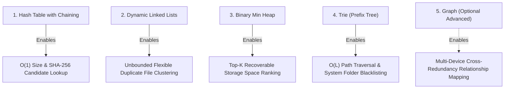
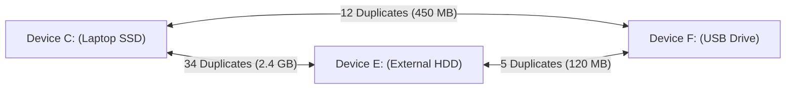

# DUPLICATE-X: Data Structures & Algorithmic Analysis
## Team DataVault | Academic Year 2026–2027

---

## 1. Overview of Data Structures in DUPLICATE-X

A central requirement of the **Data Structures and Applications (DSA)** Experiential Learning curriculum is the implementation and rigorous analysis of fundamental non-trivial data structures in pure C. Built-in language collections (such as C++ STL, Python dictionaries, or JavaScript objects) are strictly prohibited in the core backend.

DUPLICATE-X incorporates custom-built data structures, each chosen to optimize a distinct operational stage of the file deduplication and storage recovery pipeline:



---

## 2. Fundamental Algorithmic Principles & Distinctions

Before analyzing the data structures, the following core principles govern all algorithmic operations:

1. **Cryptographic Fingerprint vs. Memory Indexing Hash:**
   * **SHA-256** calculates the actual 256-bit cryptographic content fingerprint over the entire file payload.
   * **FNV-1a / Murmur3** are lightweight hashing algorithms used **strictly for internal Hash Table bucket indexing in memory** (mapping strings or integers to an array bucket $0 \le \text{idx} < \text{capacity}$). They are never used to represent file content.
2. **File Size is Strictly an Initial Filter:**
   * Filtering by file size is an $O(1)$ fast rejection pass.
   * **Equal file sizes do NOT mean files are duplicates.** Two unrelated ISO images, media files, or database backups can share identical sizes to the byte.
3. **Chunk Sampling Eliminates Candidates, Never Confirms Duplicates:**
   * Comparing head and tail 4KB chunks can rapidly eliminate distinct files of identical size.
   * Matching chunks **cannot** declare files as duplicates; it only marks them as candidates for full SHA-256 hashing.
4. **Mandatory Final Verification:**
   * Both **Full SHA-256 cryptographic hashing** and **Tier 4 byte-by-byte verification** are required before any file is declared a confirmed duplicate and presented for quarantine.

---

## 3. Detailed Data Structure Specifications

### 3.1 Hash Table with Separate Chaining

#### Purpose & Architectural Role
Deduplication requires rapid grouping of items by exact keys: first by **file size** (in Tier 1), then by **partial chunk hash** (in Tier 2), and finally by **full 64-character SHA-256 hexadecimal string** (in Tier 3). 
Separate chaining (linked lists per bucket) is selected over open addressing because:
1. Deletions and updates do not create "tombstone" artifacts.
2. Graceful degradation under high collision density.
3. Stable memory pointers to clustered duplicate groups.

#### C Structural Definition
```c
/* Bucket node for chaining collisions */
typedef struct HashNode {
    char *key;                  /* SHA-256 hex string or size string */
    void *value;                /* Pointer to DuplicateGroup or FileList */
    struct HashNode *next;      /* Collision chain pointer */
} HashNode;

/* Main hash table header */
typedef struct HashTable {
    HashNode **buckets;         /* Array of bucket pointers */
    size_t capacity;            /* Current number of buckets (prime number) */
    size_t size;                /* Number of active entries */
    double max_load_factor;     /* Threshold for resizing (typically 0.75) */
} HashTable;
```

#### Hash Functions for Internal Bucket Indexing
* **For String Keys (SHA-256 Digests):** Uses the **FNV-1a (Fowler–Noll–Vo)** 64-bit hash algorithm:
  $$\text{hash} = (\text{hash} \oplus \text{byte}) \times 1099511628211$$
  FNV-1a produces exceptional avalanche characteristics across hexadecimal character sets, distributing hashes uniformly across buckets. *Reminder: FNV-1a indexes buckets in memory; SHA-256 identifies the file content.*
* **For Integer Keys (File Size in Bytes):** Uses **MurmurHash3 64-bit finalizer**:
  $$k \mathrel{\hat{=}} k \gg 33; \quad k \times= \text{0xff51afd7ed558ccd}; \quad k \mathrel{\hat{=}} k \gg 33; \quad k \times= \text{0xc4ceb9fe1a85ec53}; \quad k \mathrel{\hat{=}} k \gg 33$$

#### Dynamic Resizing
When the load factor $\alpha = \frac{N}{B}$ exceeds $0.75$, the table reallocates to the next prime capacity roughly double in size, re-hashing all entries to preserve $O(1)$ average complexity.

---

### 3.2 Dynamic Linked Lists (Duplicate Clusters & Invariant Enforcement)

#### Purpose & Architectural Role
A single duplicate group can encompass an arbitrary number of duplicate file copies (from 2 up to hundreds across multiple connected drives). A dynamic linked list provides unbounded growth without continuous memory reallocations.

#### C Structural Definition
```c
/* Represents a specific file instance on disk */
typedef struct FileNode {
    char *filepath;             /* Full absolute path */
    uint64_t file_size;         /* Size in bytes */
    uint64_t modified_time;     /* Unix timestamp */
    char *device_id;            /* Mount point / Drive label (e.g., "C:", "USB_1") */
    bool is_root_copy;          /* True for the primary copy (protected from deletion) */
    bool is_quarantined;        /* True if moved to isolation vault */
    struct FileNode *next;      /* Next duplicate instance in this cluster */
} FileNode;

/* Master header for a cluster of identical files */
typedef struct DuplicateGroup {
    uint32_t group_id;          /* Unique numeric identifier */
    char sha256[65];            /* 64-character SHA-256 hex digest + null terminator */
    uint64_t file_size;         /* Size of one copy in bytes */
    uint32_t file_count;        /* Total number of active copies */
    uint64_t recoverable_bytes; /* (file_count - 1) * file_size */
    FileNode *files_head;       /* Linked list of file instances */
    struct DuplicateGroup *next;/* Chained in global master list */
} DuplicateGroup;
```

#### Invariant Enforcement & Copy Count Recheck
* Every `DuplicateGroup` designates exactly one `FileNode` where `is_root_copy == true`.
* Before moving any file to quarantine, the engine dynamically counts active remaining copies:
  $$\text{active\_copies} = \sum [f \in \text{files} \mid \neg f.\text{is\_quarantined}]$$
  If $\text{active\_copies} \le 1$ or the target is `is_root_copy`, the operation is blocked.

---

### 3.3 Binary Min Heap (Storage Recovery Priority Queue)

#### Purpose & Architectural Role
When a scan finishes, thousands of duplicate groups may be detected. Users require an immediate view of the **Top-K most wasteful duplicate groups** to recover maximum storage with minimal manual reviews.
Rather than sorting all $N$ groups in $O(N \log N)$ time, DUPLICATE-X maintains a **Binary Min Heap of size $K$** to find top space-wasters in $O(N \log K)$ time and $O(K)$ space.

#### C Structural Definition
```c
typedef struct HeapNode {
    uint64_t recoverable_bytes; /* Priority key: (file_count - 1) * file_size */
    DuplicateGroup *group_ref;  /* Pointer to the corresponding duplicate group */
} HeapNode;

typedef struct MinHeap {
    HeapNode *elements;         /* Dynamically allocated array of heap elements */
    size_t capacity;            /* Maximum capacity of the heap (K) */
    size_t size;                /* Current number of elements */
} MinHeap;
```

#### Heap Operations & Mathematics
* **Array Indexing:** For node at index $i$:
  $$\text{Parent}(i) = \lfloor \frac{i - 1}{2} \rfloor, \quad \text{Left}(i) = 2i + 1, \quad \text{Right}(i) = 2i + 2$$
* **Top-K Algorithm:**
  1. Initialize a Min Heap of capacity $K$.
  2. For each duplicate group $G$ in the master list:
     - If $\text{size} < K$: Insert $G$ into heap ($O(\log K)$).
     - If $\text{size} == K$: Compare $G.\text{recoverable\_bytes}$ with root element $\text{min\_val}$:
       - If $G.\text{recoverable\_bytes} > \text{min\_val}$: Extract root, insert $G$ ($O(\log K)$).
       - Else: Discard $G$.
  3. Extract elements in descending order to render the Top-K storage hogs on the dashboard.

---

### 3.4 Trie (Prefix Tree for Path Indexing & Safety)

#### Purpose & Architectural Role
Filesystem paths exhibit high hierarchical redundancy (e.g., `C:/Users/visha/Documents/`, `C:/Users/visha/Downloads/`). The Trie serves critical safety functions:
1. **System Folder Blacklist Filtering:** Instant $O(L)$ verification if a folder path falls under a protected system directory (`C:/Windows`, `System Volume Information`) regardless of the number of scanned files.
2. **Reparse Point Cycle Detection:** Verifying whether a path has already been visited to eliminate symlink recursion.
3. **Common Ancestor Analysis:** Discovering the lowest common directory hosting duplicate files.

#### C Structural Definition
```c
#define TRIE_ALPHABET_SIZE 128  /* Standard ASCII coverage */

typedef struct TrieNode {
    struct TrieNode *children[TRIE_ALPHABET_SIZE];
    bool is_end_of_path;        /* True if this node completes a registered file path */
    bool is_blacklisted;        /* True if this prefix is restricted from scanning */
    uint32_t match_count;       /* Number of indexed files rooted under this prefix */
} TrieNode;

typedef struct Trie {
    TrieNode *root;
    size_t total_paths;
} Trie;
```

#### Time Complexity Advantage
* A standard string comparison against $M$ blacklisted directories takes $O(M \times L)$ operations per file.
* The Trie accomplishes prefix validation in exactly $O(L)$ steps (where $L$ is path depth/length), completely independent of the number of blacklisted rules or scanned files.

---

### 3.5 Graph (Optional Advanced Feature: Multi-Device Redundancy Mapping)

#### Purpose & Architectural Role
As an optional advanced feature, a graph models cross-device redundancy:
* **Vertices ($V$):** Represent Storage Volumes (e.g., `C:`, `D:`, `E:`) and Directory Clusters.
* **Edges ($E$):** Weighted edges represent duplicate file overlap (number of shared duplicate files and total recoverable megabytes).



#### C Structural Definition
```c
typedef struct GraphEdge {
    uint32_t target_vertex_id;  /* Target device / directory index */
    uint32_t duplicate_count;   /* Count of identical files shared */
    uint64_t shared_bytes;      /* Total wasted storage shared between vertices */
    struct GraphEdge *next;     /* Adjacency list pointer */
} GraphEdge;

typedef struct GraphVertex {
    uint32_t vertex_id;
    char *name;                 /* Device label or directory path */
    GraphEdge *edges_head;      /* Head of adjacency list */
} GraphVertex;

typedef struct Graph {
    GraphVertex *vertices;
    uint32_t num_vertices;
    uint32_t capacity;
} Graph;
```

---

## 4. Comprehensive Complexity Analysis Table

| Data Structure | Primary Operation | Best Case | Average Case | Worst Case | Auxiliary Space |
| :--- | :--- | :--- | :--- | :--- | :--- |
| **Hash Table** | Key Lookup / Insert | $\Omega(1)$ | $\Theta(1)$ | $O(N)$ (degenerate collisions) | $O(N + B)$ ($B$ buckets) |
| **Hash Table** | Rehash / Resize | $\Omega(N)$ | $\Theta(N)$ | $O(N)$ | $O(N_{\text{new}})$ |
| **Linked List** | Append File Node | $\Omega(1)$ | $\Theta(1)$ | $O(1)$ (with tail pointer) | $O(K)$ ($K$ duplicates) |
| **Linked List** | Search Instance | $\Omega(1)$ | $\Theta(K)$ | $O(K)$ | $O(1)$ |
| **Binary Min Heap** | Insert / Heapify Up | $\Omega(1)$ | $\Theta(\log K)$ | $O(\log K)$ | $O(K)$ (fixed Top-K) |
| **Binary Min Heap** | Extract Min / Heapify | $\Omega(1)$ | $\Theta(\log K)$ | $O(\log K)$ | $O(1)$ |
| **Trie** | Path Prefix Lookup | $\Omega(1)$ | $\Theta(L)$ | $O(L)$ ($L$ = path length) | $O(\Sigma \times L \times N)$ |
| **Graph (Optional)**| Add Edge / Traverse | $\Omega(1)$ | $\Theta(V + E)$ | $O(V + E)$ | $O(V + E)$ |

---

## 5. College Viva & Viva-Voce Evaluation Guide

### Anticipated Questions & Model Defenses:

1. **Q: What is the difference between SHA-256 and FNV-1a in your project?**
   * *Defense:* SHA-256 is a 256-bit cryptographic digest computed across the entire contents of a file to generate an unambiguous content fingerprint. FNV-1a is a lightweight, non-cryptographic hash function used exclusively in RAM to map strings (such as SHA-256 hexadecimal digests) to hash table bucket indices for $O(1)$ candidate retrieval.

2. **Q: If two files have the exact same size in bytes, are they duplicates?**
   * *Defense:* No. Equal file sizes are merely an initial pre-filter ($O(1)$). Countless unrelated files (e.g., ISOs, multimedia containers, compiled binaries) share identical byte sizes. Only files that subsequently pass Tier 2 chunk sampling, Tier 3 full SHA-256 hashing, and Tier 4 byte-by-byte direct verification are confirmed duplicates.

3. **Q: Can sample chunk hashing confirm that two files are identical?**
   * *Defense:* No. Sample chunk hashing can only eliminate candidate pairs (if their head/tail chunks differ, they cannot be identical). If chunks match, they remain candidates and must undergo full SHA-256 hashing and byte-by-byte comparison before any confirmation.

4. **Q: Why can't file moves across volumes be atomic?**
   * *Defense:* In modern filesystems (NTFS, FAT32, exFAT), atomic moves (`rename`) only alter metadata pointer entries within the Master File Table (MFT) of that specific volume. Moving across volume boundaries physically requires reading data from the source disk, writing it to the destination disk, and deleting the source. DUPLICATE-X uses volume-local quarantine staging to preserve atomic moves, and a copy-verify-delete protocol for cross-volume transfers.
