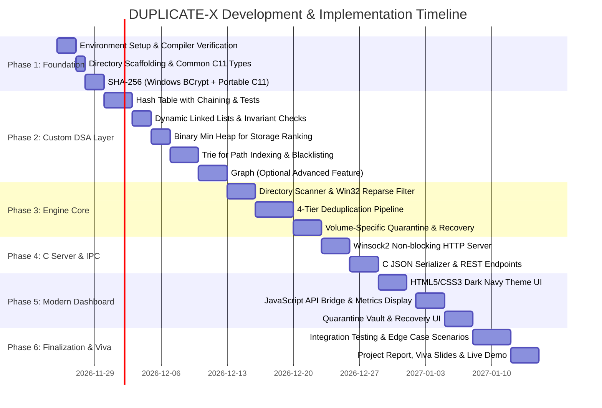

# DUPLICATE-X: Step-by-Step Implementation Roadmap
## Team DataVault | Academic Year 2026–2027

---

## 1. Roadmap Overview & Phased Milestones

The DUPLICATE-X implementation is structured into **six discrete, verifiable phases**. Every phase concludes with explicit unit tests and verification criteria to guarantee stability, memory safety, and complete adherence to college DSA academic standards.

---

## 2. Phase-by-Phase Execution Details

### Phase 1: Environment Setup & Cryptographic Foundation
* **Objective:** Establish the build system, ensure compiler readiness, and build the SHA-256 cryptographic module.
* **Tasks:**
  1. Configure GCC / MinGW-w64 on Windows via `winget` (`BrechtSanders.WinLibs.POSIX.UCRT`) and verify `gcc --version`.
  2. Create standard folder structure (`backend/`, `frontend/`, `data/`, `docs/`, `scripts/`).
  3. Author `backend/include/config.h` and `backend/include/status.h` defining project metadata and error codes.
  4. Implement Windows BCrypt hardware-accelerated SHA-256 in `backend/src/platform/windows/win_crypto.c` alongside a portable pure C11 software SHA-256 fallback in `backend/src/core/sha256_portable.c`.
  5. Author smoke test and unit tests (`backend/tests/test_sha256.c`) validating standard NIST test vectors.
* **Deliverable:** Verified SHA-256 module with 100% test vector match.

---

### Phase 2: Custom C Data Structures Subsystem
* **Objective:** Implement all core data structures in portable C11 without relying on built-in or standard library collections.
* **Tasks:**
  1. **Hash Table with Separate Chaining (`backend/src/ds/hashtable.c`):**
     - Dynamic array of bucket pointers with prime initial capacity (e.g., 1021).
     - FNV-1a string hashing for internal bucket indexing of SHA-256 hex strings; Murmur3 64-bit for file size integers.
     - Dynamic resizing when load factor $\alpha > 0.75$.
     - Unit tests (`backend/tests/test_hashtable.c`).
  2. **Linked Lists for Duplicate Groups (`backend/src/ds/linkedlist.c`):**
     - Linked list nodes tracking file instances (`FileNode`), paths, volume identifiers, and `is_root_copy` protection flags.
     - Group headers (`DuplicateGroup`) calculating aggregate recoverable space.
  3. **Binary Min Heap (`backend/src/ds/minheap.c`):**
     - Array-based min heap for maintaining Top-K duplicate groups by $( (\text{file\_count} - 1) \times \text{file\_size} )$.
     - Implements `heap_insert`, `heap_extract_min`, `heapify_up`, and `heapify_down`.
  4. **Trie Prefix Tree (`backend/src/ds/trie.c`):**
     - 128-ary ASCII trie for path prefix matching and blacklisting.
     - System folder exclusion (`C:/Windows`, `System Volume Information`) in $O(L)$ time.
  5. **Graph Subsystem (Optional Advanced Feature) (`backend/src/ds/graph.c`):**
     - Adjacency list representation connecting storage volumes and directory vertices.
     - Computes cross-device duplicate redundancy weights and shared wasted storage.
* **Deliverable:** Fully functional custom DSA library in `backend/src/ds/` with passing unit tests.

---

### Phase 3: File Scanner, 4-Tier Pipeline & Quarantine Engine
* **Objective:** Develop the core deduplication and safe file manipulation logic.
* **Tasks:**
  1. **Filesystem Scanner (`backend/src/core/scanner.c`):**
     - Win32 API (`FindFirstFileW`, `FindNextFileW`) in `platform/windows/win_io.c`.
     - Reparse point filtering (`FILE_ATTRIBUTE_REPARSE_POINT`) to avoid infinite cycles.
     - Permission error handling with non-fatal warning logs.
  2. **Four-Tier Deduplication Pipeline (`backend/src/core/dedup.c`):**
     - **Tier 1:** Filter unique sizes via size hash table ($O(1)$).
     - **Tier 2:** 4KB head/tail chunk hash sampling on size-colliding candidates (eliminates candidates, never confirms duplicates).
     - **Tier 3:** Full SHA-256 cryptographic fingerprinting over entire file contents.
     - **Tier 4:** Direct byte-by-byte comparison verifying content identity before cluster finalization.
  3. **Storage Analytics (`backend/src/core/analytics.c`):**
     - Calculate total scanned files, total duplicate clusters, and recoverable bytes.
  4. **Volume-Specific Quarantine & Recovery (`backend/src/core/quarantine.c`):**
     - Atomic move to volume-local `<Volume>:\.datavault_quarantine\<uuid>` folder.
     - Verified copy-verify-delete procedure for cross-volume staging.
     - Persistent manifest (`quarantine_manifest.json`) recording original path, timestamps, and hashes.
     - Safety rule: Verify active remaining copies $\ge 1$ and ensure `is_root_copy` is locked.
     - Restore routine returning files to their exact original location.
* **Deliverable:** Working command-line engine capable of scanning folders and safely isolating duplicates.

---

### Phase 4: Local C HTTP Server & REST API Bridge
* **Objective:** Expose the C engine via a native, zero-dependency REST HTTP server.
* **Tasks:**
  1. **Winsock2 Socket Listener (`backend/src/api/http_server.c`):**
     - Non-blocking TCP socket bound to `127.0.0.1:8080`.
     - Request parser for HTTP/1.1 methods (`GET`, `POST`, `OPTIONS`).
     - Static file handler serving HTML/CSS/JS frontend files.
  2. **Native C JSON Serializer (`backend/src/api/json_builder.c`):**
     - Lightweight buffer-based JSON builder formatting duplicate groups, heap extractions, and scan telemetry.
  3. **REST Endpoints:**
     - `/api/status`, `/api/scan/start`, `/api/scan/progress`, `/api/duplicates`, `/api/quarantine`, `/api/quarantine/restore`, `/api/stats`.
* **Deliverable:** Responsive local HTTP server communicating with browsers via standard JSON.

---

### Phase 5: Modern Dashboard Frontend
* **Objective:** Build a responsive, high-contrast Dark Navy UI for user interaction and visualization.
* **Tasks:**
  1. **Visual Styling (`frontend/css/style.css`):**
     - Dark navy and royal blue palette (`#0A1128`, `#001F54`, `#034078`, `#1282A2`, cyan accents `#00F0FF`).
     - Responsive cards and progress indicators.
  2. **Dashboard Layout (`frontend/index.html`):**
     - Stat Cards: Total Scanned, Duplicate Groups, Recoverable Space, Connected Volumes.
     - Folder Selection & Scan Control Panel.
     - Duplicate File Explorer with side-by-side path comparisons.
     - Quarantine Vault Panel with one-click restore and audit logs.
  3. **Client-Side Logic (`frontend/js/app.js`, `frontend/js/api.js`):**
     - Pure JavaScript API client polling progress and rendering duplicate groups.
     - Strict rule: JS performs zero duplicate detection; it acts purely as a presentation client.
* **Deliverable:** Complete web dashboard running locally in any modern browser.

---

### Phase 6: System Integration, Testing & Viva Defense Preparation
* **Objective:** Perform end-to-end integration tests, prepare synthetic multi-device test scenarios, and create academic viva assets.
* **Tasks:**
  1. **Synthetic Multi-Device Test Harness:**
     - Create test datasets with identical content under randomized filenames across multiple simulated drives.
     - Verify zero false positives and zero false negatives.
  2. **Edge Case Verification:**
     - Zero-byte files, large files (> 2GB), deep directory trees (> 20 levels), symlinks, locked/open files.
     - Attempting to delete the root copy (verifying strict safety rejection).
  3. **Academic Deliverables:**
     - Complete Experiential Learning Project Report.
     - Source code documentation and Doxygen-style comments.
     - Presentation slides highlighting the custom DSA architecture, Big-O benchmarks, and live demo script.
* **Deliverable:** Fully packaged, ready-to-evaluate college EL project.
