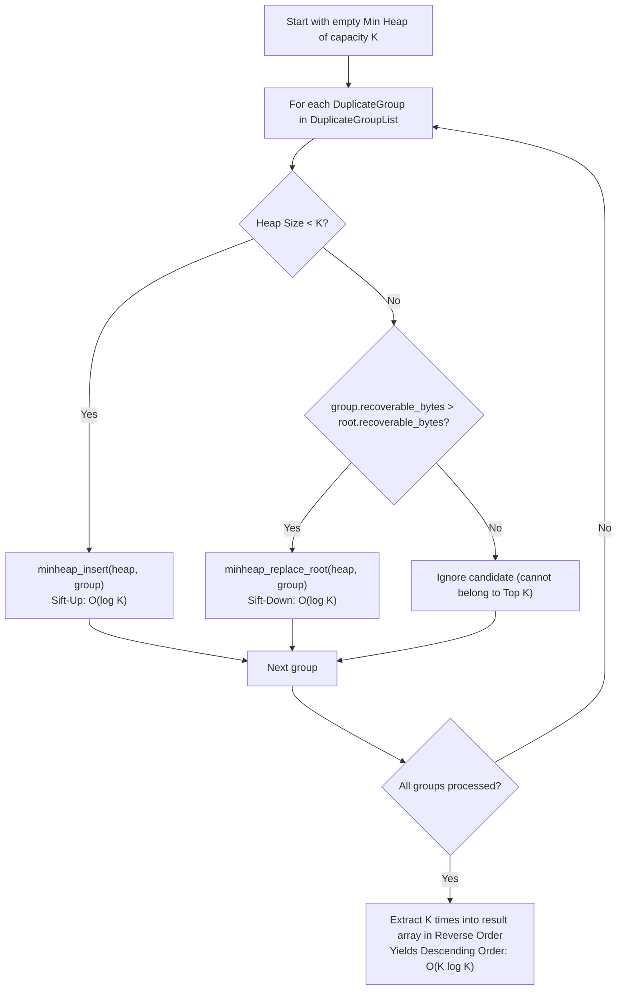

# DUPLICATE-X — PART 5A: BINARY MIN HEAP SPECIFICATION & ANALYSIS

**Team Name:** DataVault  
**Project:** DUPLICATE-X (Intelligent Multi-Device File Deduplication & Storage Optimization System)  
**Academic Year:** 2026–2027  
**Module:** Part 5A — Binary Min Heap & Top K Ranking Engine  
**Language:** C11 (`-std=c11 -Wall -Wextra -Wpedantic`)  

---

## 1. Module Overview & Objective

In a deduplication system scanning multiple terabytes across storage volumes, thousands of duplicate groups may be detected. A user rarely wants to inspect thousands of trivial duplicate text files first; they prioritize resolving the **Top $K$ largest storage-wasting duplicate groups** to reclaim maximum capacity immediately.

Rather than sorting all $G$ duplicate groups ($O(G \log G)$ time and $O(G)$ auxiliary memory), DUPLICATE-X implements a **Bounded Binary Min Heap of capacity $K$** in pure C11.
- **Time Complexity:** $O(G \log K)$
- **Auxiliary Space:** $O(K)$

---

## 2. Working Principle & Array Representation

A **Binary Min Heap** is a complete binary tree where every parent node satisfies the **Min-Heap Property**:
$$\text{key}(\text{parent}) \le \text{key}(\text{child})$$

In DUPLICATE-X:
- **Key / Metric:** `recoverable_bytes = (file_count - 1) * file_size`
- **Tie-Breaker:** Deterministic ordering using `group_id` (smaller group ID takes precedence).
- **Element Payload:** Non-owning pointers (`const DuplicateGroup *`). The heap never allocates or frees the duplicate groups; ownership remains strictly with `DuplicateGroupList`.

### Array Index Calculations (0-indexed)
For any element at index $i$:
* **Parent Index:**
  $$\text{parent}(i) = \left\lfloor \frac{i - 1}{2} \right\rfloor$$
* **Left Child Index:**
  $$\text{left}(i) = 2i + 1$$
* **Right Child Index:**
  $$\text{right}(i) = 2i + 2$$

---

## 3. Core Algorithms

### A. Sift-Up (Insert Operation)
When a new group is added:
1. Append the group at the end of the array: `items[size]`.
2. Compare the element with its parent.
3. If the element is smaller than its parent, swap them.
4. Repeat until the element is greater than or equal to its parent or reaches the root ($i = 0$).
- **Time Complexity:** $O(\log N)$

### B. Sift-Down (Extract-Min & Replace-Root)
When removing the root (the minimum) or replacing it:
1. Identify the smallest among `current`, `left_child`, and `right_child`.
2. If `current` is not the smallest, swap with the smaller child.
3. Continue downward until the heap property is satisfied or a leaf is reached.
- **Time Complexity:** $O(\log N)$

### C. Top $K$ Largest Groups Extraction Algorithm
To find the $K$ largest elements using a Min Heap of capacity $K$:

---

## 4. Complexity Analysis

| Operation | Time Complexity | Space Complexity | Explanation |
|---|:---:|:---:|---|
| **Heap Creation** | $O(1)$ or $O(K)$ | $O(K)$ | Allocates pointer array of capacity $K$. |
| **Peek Minimum** | $O(1)$ | $O(1)$ | Inspects `items[0]`. |
| **Insert** | $O(\log K)$ | $O(1)$ | Places at leaf and sifts up along tree height $\le \lceil \log_2 K \rceil$. |
| **Extract Min** | $O(\log K)$ | $O(1)$ | Moves last leaf to root and sifts down. |
| **Replace Root** | $O(\log K)$ | $O(1)$ | Replaces `items[0]` directly and sifts down. |
| **Top $K$ Processing** | $\mathbf{O(G \log K)}$ | $\mathbf{O(K)}$ | Processes $G$ groups against bounded heap of size $K \ll G$. |
| **Descending Output** | $O(K \log K)$ | $O(K)$ | $K$ extract-min operations into reversed array. |

### Why Bounded Min Heap Beats Sorting
- Sorting all groups requires $O(G \log G)$ time and $O(G)$ auxiliary memory or mutating the list.
- When $G = 1,000,000$ and $K = 5$:
  - Full Sort: $1,000,000 \times \log_2(1,000,000) \approx 20,000,000$ comparisons.
  - Bounded Min Heap: $1,000,000 \times \log_2(5) \approx 2,320,000$ comparisons — **~9x faster** and uses only **5 pointer slots of memory**!

---

## 5. Viva Examination Questions & Answers

**Q1: Why do we use a MIN heap to find the TOP K LARGEST elements? Why not a Max Heap?**  
*Answer:* A Min Heap maintains the smallest of the top candidates at its root (`items[0]`). When evaluating a new candidate, we only need an $O(1)$ comparison against `items[0]`. If the candidate is larger than the root, it knocks out the smallest candidate, replacing it in $O(\log K)$. A Max Heap would keep the largest element at root, making it impossible to determine in $O(1)$ whether a new candidate beats the *smallest* member of the top $K$.

**Q2: What happens if two duplicate groups have identical recoverable storage?**  
*Answer:* We apply deterministic tie-breaking based on `group_id`. If `recoverable_bytes` are equal, the group with the smaller `group_id` is prioritized, ensuring consistent and reproducible output across runs.

**Q3: Does the MinHeap own the DuplicateGroup memory?**  
*Answer:* No. The MinHeap stores non-owning `const DuplicateGroup *` pointers. The heap allocation and cleanup routines only manage the heap structure and its internal pointer array. The actual `DuplicateGroup` objects remain owned by `DuplicateGroupList` and are freed by `duplicate_group_list_free()`.
