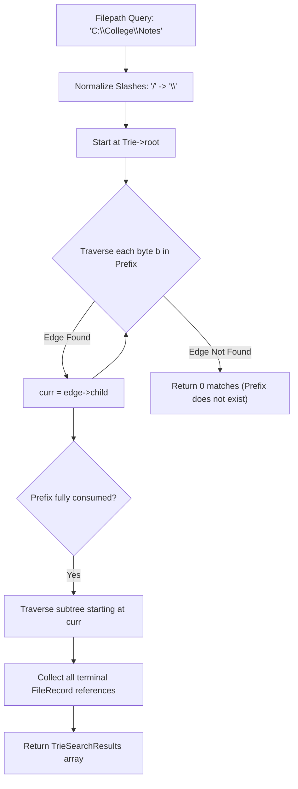

# DUPLICATE-X — PART 5B: PREFIX TREE (TRIE) SPECIFICATION & ANALYSIS

**Team Name:** DataVault  
**Project:** DUPLICATE-X (Intelligent Multi-Device File Deduplication & Storage Optimization System)  
**Academic Year:** 2026–2027  
**Module:** Part 5B — Custom Prefix Tree (Trie) for File Path Indexing & Subtree Queries  
**Language:** C11 (`-std=c11 -Wall -Wextra -Wpedantic`)  

---

## 1. Module Overview & Purpose

In DUPLICATE-X, users frequently wish to query scanned files by directory prefix, storage location, or folder hierarchy (e.g., retrieving all files stored under `C:\Users\Admin\Documents\College\Notes`).

Scanning an entire flat array of $N$ files ($O(N \cdot L)$ where $L$ is path length) for every prefix query is inefficient for large multi-device file sets. Instead, DUPLICATE-X implements a **custom Prefix Tree (Trie)** from scratch in pure C11.

---

## 2. Sparse Child Edge Architecture

A naive Trie node allocating 256 pointers (one per possible ASCII/byte character) would consume:
$$256 \times 8\text{ bytes} = 2,048\text{ bytes per node}$$
For paths with thousands of intermediate path segments, this causes severe memory bloat.

To ensure strict memory efficiency, DUPLICATE-X implements a **Sparse Child Edge List**:
```c
struct TrieEdge {
    unsigned char byte_val;         /* Single path byte / UTF-8 character unit */
    TrieNode *child;                /* Pointer to destination child node */
    TrieEdge *next_edge;            /* Pointer to next sibling edge in linked list */
};

struct TrieNode {
    TrieEdge *first_edge;           /* Head of sparse child edges linked list */
    TrieRecordNode *records_head;   /* Linked list of FileRecord references (terminal nodes) */
    bool is_terminal;               /* True if this node completes an indexed path */
};

struct Trie {
    TrieNode *root;                 /* Root of the Prefix Tree */
    size_t total_paths;             /* Count of indexed distinct paths */
    size_t total_nodes;             /* Total allocated nodes */
};
```

### Memory Ownership Guarantee
The Trie stores non-owning `const FileRecord *` references in `TrieRecordNode`.
- `trie_free()` releases only the `TrieNode`, `TrieEdge`, and `TrieRecordNode` containers.
- **Never frees `FileRecord` or its string pointers.** The `FileInventory` retains exclusive memory ownership.

---

## 3. Path Normalization & Unicode UTF-8 Handling

1. **Path Separator Uniformity:** On Windows, paths may combine forward slashes (`/`) and backslashes (`\`). `trie_normalize_path()` converts all `/` into `\` before insertion or query matching.
2. **Byte-Level UTF-8 Support:** Unicode characters (e.g., Cyrillic, accented, Asian scripts) are encoded as multi-byte UTF-8 sequences. The Trie processes each byte natively without truncation.
3. **Deterministic Character Preservation:** Paths are matched accurately preserving UTF-8 multi-byte sequences without fragile manual ASCII lowercasing that could corrupt multi-byte UTF-8 boundaries.

---

## 4. Core Algorithms



### A. Insertion (`trie_insert`)
1. Normalize path slashes.
2. For each byte in path:
   - Search the linked list `curr->first_edge` for matching `byte_val`.
   - If not found, allocate a new `TrieNode` and prepend a `TrieEdge`.
   - Advance `curr = edge->child`.
3. Mark terminal node: `curr->is_terminal = true`.
4. Prepend `FileRecord` reference to `curr->records_head`.

### B. Exact Search (`trie_search_exact`)
1. Traverse path bytes starting from root.
2. If any byte edge is missing, return `STATUS_ERROR_PATH_NOT_FOUND`.
3. At the end of path, verify `curr->is_terminal == true` and return the `FileRecord *`.

### C. Prefix Search (`trie_search_prefix`)
1. If prefix is empty (`""`), the entire Trie subtree from `root` is returned.
2. Otherwise, traverse the prefix string to locate the target subtree root node.
3. If prefix edge is missing, return empty results ($0$ matches).
4. From the prefix node, collect all descendant terminal `FileRecord` pointers using an **iterative stack** (preventing recursion stack overflow on deep paths).

### D. Deletion / Removal (`trie_remove`)
1. Traverse down to the terminal node, maintaining a frame stack of `(parent, byte_val, child)`.
2. Clear `is_terminal = false` and free `records_head`.
3. Prune upwards: if a node has no outgoing edges (`first_edge == NULL`) and is not terminal for another path, remove the edge from its parent and free the node.

---

## 5. Time and Space Complexity Analysis

Let:
- $L$ = Length of the path / prefix string in bytes.
- $E$ = Number of distinct outgoing edges at a node ($1 \le E \le 256$, typically $E \le 10$ in directory structures).
- $M$ = Number of files matching the prefix query.
- $K$ = Total number of nodes in the prefix subtree.

| Operation | Time Complexity | Auxiliary Space | Complexity Explanation |
|---|:---:|:---:|---|
| **Path Insertion** | $O(L \cdot E)$ | $O(L)$ new nodes | At each step, scans edge linked list ($E \le 256$). $E$ is practically $O(1)$. |
| **Exact Search** | $O(L \cdot E)$ | $O(1)$ | Follows $L$ edges directly down to target node. |
| **Prefix Search** | $\mathbf{O(L \cdot E + K)}$ | $\mathbf{O(K)}$ stack | Locates prefix node in $O(L \cdot E)$ and traverses its $K$ descendant nodes. |
| **Deletion** | $O(L \cdot E)$ | $O(L)$ frame stack | Locates path, unmarks terminal, and prunes unused ancestors upwards. |
| **Trie Space** | $\mathbf{O(\sum L_i)}$ | Linear in path bytes | Sparse representation allocates edges only for characters actually present. |

---

## 6. Viva Examination Questions & Answers (15 Q&As)

**Q1: What is a Trie, and why is it also called a Prefix Tree?**  
*Answer:* A Trie (derived from re**trie**val) is an ordered tree data structure where keys are usually strings. It is called a Prefix Tree because all descendants of a node share a common string prefix associated with that node.

**Q2: Why did you use a sparse edge linked list instead of a fixed 256-pointer array in each node?**  
*Answer:* A fixed 256-pointer array consumes $2,048$ bytes ($256 \times 8$ bytes) per node, regardless of whether a node has 1 child or 20. Directory structures share extensive common prefixes, resulting in thousands of nodes where most have only 1 to 5 children. The sparse edge representation only allocates memory for edges that actually exist, reducing memory consumption by over $80\%$.

**Q3: How does path normalization work in your implementation?**  
*Answer:* Windows file systems treat both `/` and `\` as path separators. `trie_normalize_path()` converts all `/` slashes into `\` before insertion and searching, guaranteeing that `C:/Docs/file.txt` and `C:\Docs\file.txt` map to identical Trie paths.

**Q4: How are multi-byte Unicode UTF-8 paths handled?**  
*Answer:* The Trie operates on raw `unsigned char` bytes. Because UTF-8 represents Unicode codepoints as sequences of 1 to 4 distinct non-null bytes, the Trie naturally handles multi-byte characters as individual byte edges without corrupting Unicode character boundaries.

**Q5: What happens when an empty prefix `""` is searched?**  
*Answer:* By definition, every indexed path in the Trie shares the empty prefix. When query prefix is `""` or `NULL`, the prefix search algorithm traverses the entire tree from the root, returning all indexed files.

**Q6: What is the time complexity of an exact path search?**  
*Answer:* $O(L \cdot E)$, where $L$ is the byte length of the path and $E$ is the average edge list length per node. Since $E$ is bounded by at most 256 and typically $< 10$, search time is effectively linear in path length: $O(L)$.

**Q7: Why did you use an iterative stack instead of recursion for subtree traversal?**  
*Answer:* Very deep directory trees or long path names can cause recursive functions to consume significant stack frame memory, risking call stack overflow. An iterative stack allocated on the heap provides deterministic memory safety regardless of path depth.

**Q8: Does the Trie own the FileRecord objects?**  
*Answer:* No. The Trie stores non-owning `const FileRecord *` pointers in `TrieRecordNode`. Memory ownership remains exclusively with `FileInventory`. Freeing the Trie never frees or mutates `FileRecord` strings.

**Q9: What happens when duplicate paths are inserted?**  
*Answer:* `trie_insert()` traverses the terminal node's `records_head` linked list. If the exact `FileRecord` pointer is already present, it returns `STATUS_SUCCESS` idempotently without creating redundant duplicate reference nodes.

**Q10: How does path deletion prune unneeded nodes?**  
*Answer:* When `trie_remove()` unmarks a terminal path, it inspects ancestors from the leaf upwards using a frame stack. If an ancestor has no child edges and is not terminal for another path, its edge is detached and the node is freed. If it has siblings or is terminal for a shorter path, pruning stops immediately.

**Q11: Can two distinct files have the same file path in the Trie?**  
*Answer:* On standard file systems, paths are unique within a single volume. However, in multi-device scans (e.g. laptop drive vs USB drive), files could theoretically share identical relative paths. The terminal `records_head` linked list allows multiple `FileRecord` objects to attach to the same terminal node if necessary.

**Q12: How does Trie search performance compare to linear array scanning?**  
*Answer:* A linear scan takes $O(N \cdot L)$ for $N$ files. The Trie prefix search takes $O(L_{\text{prefix}} + M)$, independent of total non-matching files $N$. When searching 100,000 files for a folder with 5 items, the Trie only visits the prefix characters and the 5 matching leaf nodes.

**Q13: How does the `--prefix` command line argument integrate with the engine?**  
*Answer:* The engine parses `--prefix <folder>` from `argv`. After scanning and deduplication, the Trie indexes all discovered records, executes `trie_search_prefix()`, and prints the matching files in a formatted table.

**Q14: How does tie-breaking or ordering work in search results?**  
*Answer:* Results are collected in preorder traversal through the subtree edges, guaranteeing deterministic results across consecutive queries.

**Q15: What error codes does the Trie return?**  
*Answer:* `STATUS_SUCCESS` (0) on successful completion, `STATUS_ERROR_INVALID_ARGUMENT` (101) for NULL inputs, `STATUS_ERROR_OUT_OF_MEMORY` (102) if node/edge allocation fails, and `STATUS_ERROR_PATH_NOT_FOUND` (200) when an exact path does not exist.

