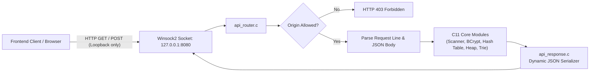

# DUPLICATE-X — PART 6A: LOCAL C BACKEND HTTP REST API SPECIFICATION

**Team Name:** DataVault  
**Project:** DUPLICATE-X (Intelligent Multi-Device File Deduplication & Storage Optimization System)  
**Academic Year:** 2026–2027  
**Module:** Part 6A — Local C Backend HTTP REST API (Winsock2)  
**Language:** C11 (`-std=c11 -Wall -Wextra -Wpedantic`)  

---

## 1. Architectural Overview & Objective

To enable seamless integration between the high-performance C11 backend and future web-based user dashboards (HTML5, CSS3, Vanilla JS), DUPLICATE-X provides a **lightweight, native HTTP/1.1 REST API server implemented entirely in C using Windows Winsock2**.

### Key Architectural Tenets:
* **Zero External Web Frameworks:** Implemented directly on top of Winsock2 (`ws2_32.lib`) with manual socket handling, HTTP request line/header parsing, and JSON generation.
* **Strict Loopback Binding:** Binds **exclusively to `127.0.0.1:8080`**. Never binds to `0.0.0.0` or exposes the server to external LAN/WAN interfaces.
* **Non-Owning Memory Model:** The API request handlers never alter or free engine data structures directly. Memory ownership remains with `ApiEngineContext`, `FileInventory`, `DuplicateGroupList`, and `Trie`.
* **Dynamic Response Growth:** Uses dynamically growing buffers (`ApiResponseBuffer`) that expand as needed to serialize arbitrarily large duplicate group lists without buffer overflow risks.

---

## 2. API Endpoints Reference

### A. `GET /api/health`
Health and identification heartbeat endpoint.
* **Response (HTTP 200 OK):**
```json
{
  "status": "ok",
  "application": "DUPLICATE-X",
  "team": "DataVault",
  "version": "1.0"
}
```

### B. `POST /api/scan`
Executes synchronous recursive traversal, SHA-256 fingerprinting, candidate Hash Table separate chaining, byte-by-byte comparison, and Trie indexing across user-specified directories.
* **Request Payload (application/json):**
```json
{
  "directories": [
    "C:\\Users\\User\\Documents",
    "D:\\Backup"
  ]
}
```
* **Response (HTTP 200 OK):**
```json
{
  "status": "success",
  "directories_scanned": 2,
  "files_discovered": 142,
  "files_successfully_hashed": 142,
  "duplicate_groups": 12,
  "duplicate_copies": 28,
  "recoverable_bytes": 104857600,
  "scan_status": "COMPLETED"
}
```

### C. `GET /api/stats`
Telemetry metrics from the most recent scan session.
* **Response (HTTP 200 OK):**
```json
{
  "total_scanned_files": 142,
  "successfully_hashed_files": 142,
  "duplicate_groups": 12,
  "duplicate_copies": 28,
  "recoverable_bytes": 104857600,
  "last_scan_status": "COMPLETED"
}
```

### D. `GET /api/duplicates`
Returns all confirmed duplicate groups with their individual files and locations.
* **Response (HTTP 200 OK):**
```json
{
  "total_groups": 1,
  "total_duplicate_copies": 2,
  "total_recoverable_bytes": 1024,
  "groups": [
    {
      "group_id": 1,
      "file_size": 1024,
      "file_count": 2,
      "recoverable_bytes": 1024,
      "sha256": "ba7816bf8f01cfea414140de5dae2223b00361a396177a9cb410ff61f20015ad",
      "files": [
        {
          "filename": "document.pdf",
          "filepath": "C:\\Docs\\document.pdf",
          "device_id": "Drive_C"
        },
        {
          "filename": "copy.pdf",
          "filepath": "D:\\Backup\\copy.pdf",
          "device_id": "Drive_D"
        }
      ]
    }
  ]
}
```

### E. `GET /api/top-k?k=5`
Utilizes the **Part 5A Binary Min Heap** to retrieve the Top $K$ storage-recovery opportunities in descending order.
* **Query Parameter:** `k` (Integer, default 5, maximum 1000).

### F. `GET /api/search/prefix?prefix=<percent_encoded_prefix>`
Utilizes the **Part 5B Prefix Trie** to retrieve all indexed file paths matching the directory or filename prefix.
* **Query Parameter:** `prefix` (URL percent-encoded string).

---

## 3. Winsock2 Architecture & Security Enforcement



### Security Measures:
1. **Loopback Only:** Binds explicitly to `inet_addr("127.0.0.1")`. It will never accept incoming SYN packets from external network adapters.
2. **CORS Local Origin Allowlist:** `api_is_origin_allowed()` strictly permits localhost (`http://localhost:...`, `http://127.0.0.1:...`). It **rejects** wildcard origins (`*`) and public external web origins.
3. **Request Size Ceiling:** Requests larger than $64\text{ KB}$ are rejected, preventing memory exhaustion attacks.
4. **Socket Timeouts:** 5-second `SO_RCVTIMEO` and `SO_SNDTIMEO` are enforced to prevent stale TCP connection starvation.

---

## 4. Complexity Analysis of Key API Endpoints

| Endpoint | Underlying DSA Engine | Time Complexity | Auxiliary Space |
|---|---|:---:|:---:|
| `GET /api/health` | Static status | $O(1)$ | $O(1)$ |
| `POST /api/scan` | Scanner + SHA-256 + Hash Table + Byte Compare | $O(N \cdot L + \text{Bytes})$ | $O(N)$ |
| `GET /api/stats` | State telemetry | $O(1)$ | $O(1)$ |
| `GET /api/duplicates` | Linked list traversal | $O(G + C)$ | $O(G + C)$ serialized JSON |
| `GET /api/top-k?k=K` | Binary Min Heap | $\mathbf{O(G \log K)}$ | $O(K)$ |
| `GET /api/search/prefix` | Prefix Tree (Trie) | $\mathbf{O(L_{\text{prefix}} + M)}$ | $O(M)$ |

---

## 5. Starting and Running the API Server

### Running via Main Executable:
```powershell
backend/build/duplicate-x.exe --server
```

### Running Test Verification Suite:
```powershell
powershell -ExecutionPolicy Bypass -File scripts/test_api.ps1
```

---

## 6. Viva Examination Questions & Answers (15 Q&As)

**Q1: Why did you implement an HTTP REST server in C instead of using Node.js or Python?**  
*Answer:* The core objective of DUPLICATE-X is demonstrating systems-level programming and DSA proficiency in pure C11. Running an embedded Winsock2 server in C eliminates external runtimes, minimizes binary size, operates with near-zero latency, and allows direct in-memory access to our custom C data structures without serialization overhead across separate language runtimes.

**Q2: What is Winsock2, and what are the essential functions used to create a server?**  
*Answer:* Winsock2 (Windows Sockets 2) is the native networking API on Windows. The core lifecycle sequence is: `WSAStartup` (initializes networking DLL), `socket` (creates communication endpoint), `bind` (associates socket with local IP and port), `listen` (marks socket as passive), `accept` (accepts incoming connection), `recv`/`send` (data I/O), `closesocket` (terminates connection), and `WSACleanup` (releases resources).

**Q3: How does the server guarantee it does not expose the user's files to the local area network?**  
*Answer:* In `api_server.c`, `srv_addr.sin_addr.s_addr` is set to `inet_addr("127.0.0.1")` instead of `INADDR_ANY` (`0.0.0.0`). The Windows TCP/IP stack will drop any packets arriving on physical LAN interfaces attempting to reach port 8080.

**Q4: How does `ApiResponseBuffer` prevent buffer overflows?**  
*Answer:* Rather than writing to a fixed-size buffer, `api_buffer_append` calculates the total string length needed. If `needed > capacity`, it dynamically reallocates memory using `realloc()` by doubling the buffer capacity until all characters fit safely.

**Q5: How does the JSON serializer escape dangerous characters?**  
*Answer:* `api_buffer_append_escaped_json` iterates byte-by-byte and replaces quotes (`\"`), backslashes (`\\\\`), newlines (`\\n`), carriage returns (`\\r`), tabs (`\\t`), and ASCII control characters ($< 0x20$) with standard `\\u00XX` unicode escape sequences.

**Q6: What is CORS and why is a wildcard `Access-Control-Allow-Origin: *` dangerous?**  
*Answer:* Cross-Origin Resource Sharing (CORS) dictates which websites can request local resources. A wildcard `*` would allow any malicious web page visited in a browser to issue fetch requests to `http://127.0.0.1:8080` and steal file manifests. DUPLICATE-X enforces a strict local origin check allowing only `http://localhost` and `http://127.0.0.1`.

**Q7: How are URL query parameters decoded?**  
*Answer:* `api_url_decode()` converts '+' into spaces and translates 3-byte percent sequences (`%XX`) into their raw byte equivalent by converting hex characters into integers.

**Q8: How does the `GET /api/top-k` endpoint leverage Part 5A?**  
*Answer:* It parses `k` from the query string, allocates a bounded Min Heap of capacity $K$, runs `minheap_get_top_k()` in $O(G \log K)$ time, and serializes the descending result array into JSON.

**Q9: How does the `GET /api/search/prefix` endpoint leverage Part 5B?**  
*Answer:* It URL-decodes the `prefix` parameter, passes it to `trie_search_prefix()`, and retrieves only the matching files in $O(L_{\text{prefix}} + M)$ without scanning the remaining non-matching inventory.

**Q10: What HTTP status code is returned when an invalid method is sent?**  
*Answer:* HTTP 405 Method Not Allowed (e.g., sending `DELETE /api/health`).

**Q11: What HTTP status code is returned for malformed JSON?**  
*Answer:* HTTP 400 Bad Request.

**Q12: How is the server shut down cleanly?**  
*Answer:* `api_server_run` checks `g_server_running` every 1 second using non-blocking `select()`. When a shutdown signal is received, it breaks out of the loop, closes the listening socket, and calls `WSACleanup()`.

**Q13: Does the API response generator free file records?**  
*Answer:* No. The API response generator only serializes data into dynamic buffers. `FileRecord` structures remain exclusively owned by `FileInventory` and are deallocated only when `api_engine_context_cleanup()` or engine shutdown is triggered.

**Q14: How does the server handle large HTTP requests?**  
*Answer:* It enforces `API_MAX_REQUEST_SIZE = 65536` ($64\text{ KB}$). Requests exceeding this threshold or with missing headers are rejected with HTTP 400.

**Q15: Why is synchronous scan execution acceptable in Part 6A?**  
*Answer:* In Part 6A, synchronous execution keeps the architecture deterministic and straightforward without multithreading race conditions on `FileInventory`. The API contract allows background asynchronous tasks to be added seamlessly in future phases without breaking the JSON schema.
