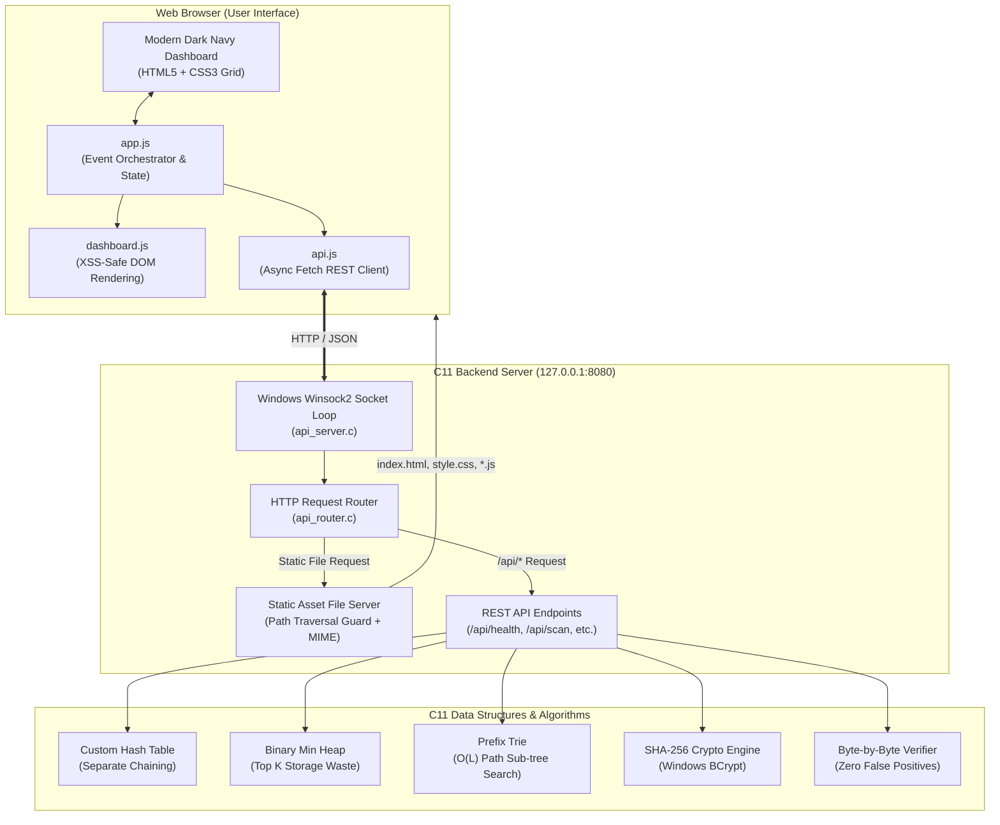

# DUPLICATE-X — PART 6B: FRONTEND DASHBOARD & C API INTEGRATION

**Team Name:** DataVault  
**Project:** DUPLICATE-X (Intelligent Multi-Device File Deduplication & Storage Optimization System)  
**Academic Year:** 2026–2027  
**Module:** Part 6B — Frontend Dashboard & Local C API Integration  
**Backend:** C11 (`-std=c11 -Wall -Wextra -Wpedantic -lws2_32 -lbcrypt`)  
**Frontend:** HTML5, CSS3, Vanilla JavaScript (Zero external dependencies / Zero npm packages)  
**Communication:** Native HTTP/1.1 REST API + JSON over Loopback (`127.0.0.1:8080`)  

---

## 1. Architectural Overview & System Flow

DUPLICATE-X Part 6B completes the full-stack loop of the system:
1. The **C11 backend server** (`api_server.c`, `api_router.c`) acts as both the high-performance deduplication engine and the HTTP web server.
2. The **HTTP server** directly serves the frontend static assets (`index.html`, `style.css`, `app.js`, `api.js`, `dashboard.js`) and handles all REST API endpoints under `/api/*`.
3. The **Frontend User Interface** runs in any modern browser without requiring Node.js, npm, or heavy JavaScript frameworks.

---

## 2. Static Asset Routing & Security in C

### A. Same-Origin Architecture
By having the C Winsock2 server directly serve the static frontend files from the local `frontend/` directory, the UI and API share the exact same origin (`http://127.0.0.1:8080`). This completely eliminates Cross-Origin Resource Sharing (CORS) complications, preflight roundtrips, and browser security blocks.

### B. Path Traversal Protection
Exposing a local file server poses directory traversal risks if an attacker attempts requests like `GET /../../Windows/System32/config/SAM`.  
In `backend/src/api/api_router.c`, `handle_static_file()` implements strict validation:
1. Rejects any path containing `..` (parent directory traversal).
2. Rejects any path containing `:` (Windows drive letters or alternate data streams).
3. Rejects any path containing `\` (backslash normalization bypass attempts).
4. Defaults root path `/` to `/index.html`.
5. Resolves relative to `frontend/` (and fallback `../frontend/`).
6. If traversal or unauthorized characters are detected, immediately aborts with **HTTP 403 Forbidden**.

### C. MIME Content-Type Resolution
The C server detects file extensions and appends standard RFC-compliant `Content-Type` headers:
* `.html`, `.htm` &rarr; `text/html; charset=utf-8`
* `.css` &rarr; `text/css; charset=utf-8`
* `.js` &rarr; `application/javascript; charset=utf-8`
* `.json` &rarr; `application/json; charset=utf-8`
* `.png` &rarr; `image/png`
* `.jpg`, `.jpeg` &rarr; `image/jpeg`
* `.ico` &rarr; `image/x-icon`
* `.svg` &rarr; `image/svg+xml`
* Default &rarr; `text/plain; charset=utf-8`

---

## 3. Frontend UI/UX Design & Aesthetic

* **Theme:** Premium Dark Navy commercial design language.
  * Base Background: `#070b14`
  * Card Background: `#0f172a`
  * Input & Subtle Surfaces: `#090e1a` / `#141e33`
  * Borders: `#223049` (hover `#334769`)
  * Primary Accent: Cyan `#06b6d4` (glow `rgba(6, 182, 212, 0.2)`)
  * Secondary Accents: Royal Blue `#3b82f6`, Emerald Green `#10b981`, Amber `#f59e0b`, Red `#ef4444`.
* **Typography:** Clean system sans-serif font stack (`system-ui, -apple-system, Segoe UI, Roboto`) with monospace numbers and hashes (`Consolas, Monaco, Fira Code`).
* **Visual Hierarchy:**
  1. **Application Header:** Brand identity ("DataVault DUPLICATE-X"), tagline ("Smarter Storage. Zero Duplicate Waste."), live server connection status pill (pulsing green dot for online, red for offline), and manual refresh button.
  2. **4 Telemetry Metrics Cards:**
     * *Total Files Scanned:* Discovered filesystem entries across targeted paths.
     * *Successfully Hashed:* Files with computed cryptographic SHA-256 signatures.
     * *Duplicate Groups:* Number of clusters with redundant copies.
     * *Recoverable Storage:* Highlighted green card displaying human-readable reclaimable bytes (e.g. `1.42 GB`).
  3. **Target Storage Directories Queue:** Text input for Windows absolute paths (`C:\Users\...`), "Add Directory" button, dynamic badge list of folders with removal (`×`) buttons, and prominent "Run Deduplication Scan" button with loading spinner.
  4. **Top Storage Waste Rankings (Binary Min Heap):** Ranks the top storage-wasting groups (#1, #2, #3...) directly from the C Binary Min Heap (`GET /api/top-k?k=5`), with visual proportional recovery bars.
  5. **Duplicate File Explorer (Hash Table & Linked Lists):** Expandable accordion cards per duplicate group. Shows group ID, primary filename, recoverable waste pill, copy count, and truncated SHA-256. When expanded, displays a structured table labeling the original reference file (`Original / Keep`) and subsequent duplicates (`Duplicate`), along with path and device ID. Includes live search filter.
  6. **Fast Path Prefix Search (Prefix Trie):** Sub-tree query input linked to `GET /api/search/prefix?prefix=...`, rendering all matching file records from the Trie in $O(L)$ time.

---

## 4. Frontend Modular JavaScript Architecture

The client-side code is structured into three clean, decoupled vanilla JavaScript modules:

### 1. `frontend/js/api.js` (REST Client)
* Encapsulates all asynchronous `fetch()` operations to the C backend.
* Handles HTTP errors, non-200 status codes, and JSON response parsing.
* Exposes clean async methods: `getHealth()`, `getStats()`, `getDuplicates()`, `getTopK(k)`, `searchPrefix(prefix)`, and `triggerScan(directories)`.

### 2. `frontend/js/dashboard.js` (DOM Rendering & Presentation)
* Contains pure UI rendering functions and formatting utilities.
* Implements robust security helpers:
  * `escapeHtml(str)`: Escapes `&`, `<`, `>`, `"`, `'` to guarantee zero Cross-Site Scripting (XSS).
  * `formatBytes(bytes)`: Formats numeric bytes into B, KB, MB, GB, TB.
  * `truncateHash(hash)`: Truncates 64-character SHA-256 hex into `ba7816bf...15ad`.
* Renders metrics, directory chips, Top K ranking bars, accordion groups, and Trie results.

### 3. `frontend/js/app.js` (Application Controller & State)
* Manages central application state: `directories`, `stats`, `duplicateGroups`, `topKGroups`, `isScanning`.
* Registers DOM event listeners for buttons, inputs, Enter keys, and filter debouncing.
* Controls the scan workflow (disabling buttons, displaying progress spinner, reloading state upon completion).
* Runs a periodic background health-check heartbeat every 10 seconds.

---

## 5. Verification & Test Suite

The test suite in `backend/tests/test_api.c` was expanded to **18 comprehensive verification scenarios**:

| Test # | Endpoint / Target | Assertion / Behavior Tested | Result |
| :---: | :--- | :--- | :---: |
| **TEST 1** | `GET /api/health` | Returns HTTP 200 OK | **PASS** |
| **TEST 2** | `GET /api/health` | JSON contains application `"DUPLICATE-X"` | **PASS** |
| **TEST 3** | `GET /api/health` | JSON contains team `"DataVault"` | **PASS** |
| **TEST 4** | `GET /api/unknown` | Unknown endpoint returns HTTP 404 Not Found | **PASS** |
| **TEST 5** | `DELETE /api/health`| Unsupported HTTP method returns HTTP 405 | **PASS** |
| **TEST 6** | `POST /api/scan` | Malformed JSON payload returns HTTP 400 | **PASS** |
| **TEST 7** | `POST /api/scan` | Empty directories array returns HTTP 400 | **PASS** |
| **TEST 8** | `OPTIONS /api/health` | CORS preflight returns HTTP 204 No Content | **PASS** |
| **TEST 9** | `GET /api/stats` | Returns total files, hashed count, duplicate groups | **PASS** |
| **TEST 10** | `GET /api/duplicates` | Returns duplicate groups array with files | **PASS** |
| **TEST 11** | `GET /api/duplicates` | Verifies SHA-256 fingerprints in group | **PASS** |
| **TEST 12** | `GET /api/top-k?k=1` | Min heap extracts top storage-wasting group | **PASS** |
| **TEST 13** | `GET /api/top-k?k=-3`| Negative/invalid K returns HTTP 400 | **PASS** |
| **TEST 14** | `GET /api/search/prefix` | Trie prefix query returns matching files | **PASS** |
| **TEST 15** | `GET /api/search/prefix` | Missing prefix returns all indexed files cleanly | **PASS** |
| **TEST 16** | `GET /` | Serves frontend `index.html` with `text/html` | **PASS** |
| **TEST 17** | `GET /css/style.css` | Serves CSS stylesheet with `text/css` | **PASS** |
| **TEST 18** | `GET /../secret.txt` | Directory traversal attempt blocked with HTTP 403 | **PASS** |

---

## 6. Comprehensive Viva Q&A Guide (15 Technical Questions)

**Q1: Why did you build the frontend in Vanilla JavaScript rather than React, Vue, or Angular?**  
*Answer:* Vanilla JavaScript requires zero runtime dependencies, zero build steps (`npm run build`, Webpack, Vite), and zero external Node.js dependencies. This aligns with DUPLICATE-X's core design goal: a standalone, lightweight, high-performance C binary that can run self-contained on any Windows machine.

**Q2: How does the C backend serve static assets alongside REST API endpoints?**  
*Answer:* `api_router.c` inspects the HTTP request path. If the path starts with `/api/`, it routes to the corresponding REST handler (`handle_health`, `handle_scan`, etc.). If the path does not start with `/api/`, it calls `handle_static_file()`, which checks security constraints, maps `/` to `/index.html`, opens the file from the `frontend/` directory, detects its MIME type, and streams it back via `api_build_raw_http_response()`.

**Q3: How does serving static assets from the C server eliminate CORS issues?**  
*Answer:* Cross-Origin Resource Sharing (CORS) is enforced by browsers when JavaScript running on one origin (e.g. `http://localhost:3000`) tries to fetch resources from a different origin (e.g. `http://localhost:8080`). When the C server serves both HTML/JS and the API from `127.0.0.1:8080`, they share the exact same origin (same protocol, host, and port), so CORS restrictions do not apply.

**Q4: How does the C backend protect against Directory Traversal attacks?**  
*Answer:* `handle_static_file()` checks the decoded URL path for `..` (parent traversal), `:` (drive letters and alternate data streams), and `\` (path separator manipulation). If any of these are present, the server refuses to open the path and immediately returns `HTTP 403 Forbidden`. Furthermore, all opened paths are prefixed with the safe directory `frontend/`.

**Q5: How does the frontend prevent Cross-Site Scripting (XSS) when rendering user file paths?**  
*Answer:* File paths and filenames can contain characters such as `<`, `>`, `"`, or `'`. In `dashboard.js`, dynamic content is either assigned directly to `textContent` (which browsers render as literal text without parsing as HTML) or passed through `escapeHtml()` which converts special characters to HTML entities (`&lt;`, `&gt;`, `&quot;`, `&#039;`).

**Q6: Why can standard HTML file input pickers (`<input type="file" webkitdirectory>`) not provide absolute Windows paths?**  
*Answer:* Standard browser security models intentionally sandbox file pickers to prevent web pages from discovering the host's full filesystem structure (e.g. `C:\Users\Username\Secret`). Browsers only expose relative paths within the selected folder. To allow DUPLICATE-X to scan arbitrary native Windows drives and paths, our UI provides a native text input queue where users enter exact Windows paths (`C:\...`, `D:\...`).

**Q7: How is the Top K Storage Waste ranking computed and displayed?**  
*Answer:* When `GET /api/top-k?k=5` is called, the C backend uses our custom C11 Binary Min Heap (`minheap.c`). It maintains a heap of capacity $K$, pushing candidate duplicate groups and evicting the root when capacity is exceeded, completing in $O(N \log K)$ time. The sorted result is sent as JSON, and `dashboard.js` renders rank badges (#1, #2...) with visual proportional storage waste bars.

**Q8: How does the UI visually distinguish between the original file and duplicate copies?**  
*Answer:* In each duplicate group, the first file record in the linked list represents the reference file discovered first during traversal. In the Duplicate File Explorer table, the first record is highlighted with an `Original / Keep` blue pill badge, while all subsequent copies are marked with an `Duplicate` amber badge.

**Q9: How is the Prefix Trie utilized from the dashboard?**  
*Answer:* Users enter a path prefix (e.g. `C:\Users\User` or `D:\Backup`) into the Path Prefix Search box. On click or Enter, `api.js` calls `GET /api/search/prefix?prefix=...`. The C engine walks down the Trie character nodes in $O(L)$ time and collects all indexed file pointers in the sub-tree, returning matching paths, device IDs, and sizes.

**Q10: What happens if a user starts a scan on very large directories? Does the UI freeze?**  
*Answer:* The browser UI uses asynchronous JavaScript (`async/await` and non-blocking `fetch`). While the C engine processes the scan, the UI displays an active loading spinner and disables the scan button to prevent concurrent submissions. The browser event loop remains fully responsive.

**Q11: How does the C backend handle memory allocation for binary and text HTTP payloads?**  
*Answer:* In `api_build_raw_http_response()`, the server calculates the exact payload length via `fseek`/`ftell`, allocates memory, reads the static file into memory, formats the HTTP headers with `Content-Length`, and sends it to the socket. Once the response buffer is transferred, all heap memory is freed immediately.

**Q12: How does the client detect if the C backend server is shut down?**  
*Answer:* `app.js` runs a periodic heartbeat check (`checkHealth()`) every 10 seconds calling `GET /api/health`. If the server terminates or the socket connection is refused, the `fetch` call throws an exception, and `renderConnectionStatus(false)` immediately switches the header badge to a red "Server Offline" indicator.

**Q13: How does the client filter duplicate groups without querying the server again?**  
*Answer:* Once duplicate groups are fetched from `GET /api/duplicates`, they are retained in client-side state (`state.duplicateGroups`). As the user types into the search box, `dashboard.js` filters the local array in real time across primary filename, SHA-256 fingerprint, and contained paths, updating the accordion instantly without network overhead.

**Q14: Why is HTTP/1.1 `Connection: close` used for responses?**  
*Answer:* Using `Connection: close` ensures a simple, robust request-response transaction model. The Winsock server processes the request, sends the response, flushes the socket, and closes the connection. This prevents stalled keep-alive sockets from exhausting local file descriptors.

**Q15: How does DUPLICATE-X ensure that duplicate files are genuinely identical before reporting them on the dashboard?**  
*Answer:* DUPLICATE-X employs a rigorous two-tier verification pipeline:
1. Files must have matching sizes and identical cryptographic SHA-256 hashes generated via Windows BCrypt.
2. Even with identical SHA-256 hashes, the engine performs byte-by-byte comparison (`win_file_compare.c`) using 64 KB buffered reads. Only when every single byte matches is a duplicate confirmed, ensuring 100% mathematical certainty with zero false positives.
